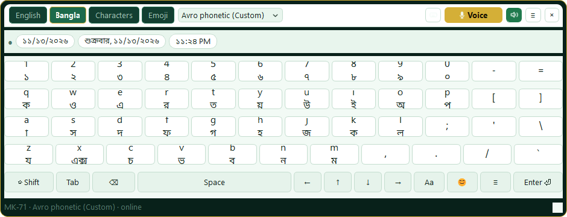

# MK-71 Keyboard

**বাংলা + English অন-স্ক্রিন কিবোর্ড, ভয়েস টাইপিং আর AI প্রুফরিডিং — Windows ৭ থেকে ১১ পর্যন্ত।**
An all-in-one Bangla and English keyboard for Windows: phonetic typing, an
on-screen keypad, voice dictation and optional AI proofreading, in one small app.

## Why MK-71

- **দুটো ভাষা, এক অ্যাপ** — Avro/ফোনেটিক বা ফিক্সড বাংলা লেআউট, আর সাধারণ ইংরেজি কিবোর্ড।
- **অন্য অ্যাপেও বাংলা** — Ctrl+Alt+K দিয়ে Chrome, Word, Notepad, WhatsApp — যেকোনো জায়গায় বাংলা টাইপ।
- **অন-স্ক্রিন কিবোর্ড** — মাউস/টাচ দিয়ে বাংলা, ইংরেজি, চিহ্ন ও ইমোজি।
- **গ্লাস লুক** — ডার্ক ও হোয়াইট দুই থিমেই ট্রান্সপারেন্ট প্যানেল, সলিড কী-ক্যাপ।
- **ভয়েস টাইপিং** — মাইকে বলুন, লেখা বসে যাবে। Google Cloud, Groq Whisper, Deepgram, Sarvam AI বা ফ্রি Google Web Speech।
- **এনকোডিং কনভার্টার** — ANSI / Bijoy / Probhat ↔ Unicode।
- **সাজেশন ও অটো-কারেকশন** — পরের শব্দ, তারিখ, সময়, সংখ্যা, ইমোজি, ক্যালকুলেটর।
- **AI প্রুফরিডিং (ঐচ্ছিক)** — বানান-যতিচিহ্ন ঠিক, সমার্থক শব্দ, অনুবাদ; key না দিলেও লোকাল প্রুফরিড চলে।
- **অফলাইনে কাজ করে** — টাইপিং, কনভার্টার ও লোকাল প্রুফরিড ইন্টারনেট ছাড়াই; কোনো ট্র্যাকিং নেই।

## ডাউনলোড / Download

সর্বশেষ বিল্ড → **[Releases](../../releases/latest)**

| ফাইল | কাদের জন্য |
|---|---|
| `Windows_x64_Portable.zip` | ৬৪-বিট উইন্ডোজ (সবচেয়ে সাধারণ) — আনজিপ করে চালান, ইনস্টল লাগে না |
| `Windows_x32_Portable.zip` | পুরোনো ৩২-বিট উইন্ডোজ ৭/৮.১ |
| `Windows_x64_Installer.zip` / `Windows_x32_Installer.zip` | সেটআপ উইজার্ডসহ |

প্রতিটি জিপের ভেতরে **`MK-71 Keyboard - User Guide.pdf`** (২০ পৃষ্ঠার সম্পূর্ণ বাংলা গাইড)
এবং **`INSTALL.txt`** আছে। গাইডটি রেপোতেও রাখা আছে:
[User Guide](docs/MK-71%20Keyboard%20-%20User%20Guide.pdf)।

> SmartScreen বা antivirus সতর্কতা দেখালে **More info → Run anyway**। অ্যাপটি unsigned
> ও ফ্রি, তাই উইন্ডোজ প্রকাশক চিনতে চায়। প্রতিটি রিলিজের SHA-256 নিচে দেওয়া থাকে।

## দ্রুত শুরু

1. জিপ আনজিপ করুন → `MK-71 Keyboard.exe` চালান।
2. টপ বার পর্দার উপরে-মাঝখানে আসবে: 🎙 মাইক, **বাংলা/English**, আর বাকি আইকন।
3. টাইপ করতে **⚙ → On-screen keyboard** (`Ctrl+Alt+O`), অথবা অন্য অ্যাপে বাংলা লিখতে
   `Ctrl+Alt+K`।
4. ভয়েস টাইপিং: 🎙 চাপুন (বা `Ctrl+Alt+V`), বলুন, থামলে লেখা বসে যাবে।

## ভয়েস টাইপিং: কোন সার্ভিসে কী লাগে

| সার্ভিস | কী লাগবে | ফ্রি |
|---|---|---|
| Google Web Speech | কিছুই না (ডিফল্ট) | হ্যাঁ, unofficial |
| Google Cloud Speech-to-Text | API key + billing চালু | মাসে ৬০ মিনিট |
| Whisper / OpenAI-compatible (Groq) | endpoint + key | দৈনিক ফ্রি কোটা |
| Deepgram (nova-3) | API key | এককালীন $২০০ ক্রেডিট |
| Sarvam AI | API key | এককালীন ₹১০০ ক্রেডিট |

Settings → **Speech to Text**-এ **“How to set API key”** বাটন আছে; সেখানে প্রতিটি
সার্ভিসের ধাপে ধাপে নির্দেশনা ও ক্লিকেবল সাইট লিংক রয়েছে। কোটা শেষ হলে অ্যাপ নিজেই
ফ্রি সার্ভিসে নেমে যায়, আর কোটা ফিরলে নিজে থেকেই উন্নত সার্ভিসে ফিরে আসে।

## শর্টকাট

| শর্টকাট | কাজ |
|---|---|
| `Ctrl + Alt + V` | ভয়েস টাইপিং চালু/বন্ধ |
| `Ctrl + Alt + K` | অন্য অ্যাপে বাংলা টাইপিং চালু/বন্ধ |
| `Ctrl + Shift + L` | বাংলা ↔ English |
| `Ctrl + Alt + X` | বাংলা টাইপিং সাথে সাথে বন্ধ |
| `Ctrl + Alt + O` | অন-স্ক্রিন কিবোর্ড দেখানো/লুকানো |
| `Ctrl + Shift + E` | এনকোডিং কনভার্টার |
| `Ctrl + Alt + A` | AI tools (প্রুফরিড, সমার্থক, অনুবাদ) |

সব শর্টকাট Settings → **Shortcuts** থেকে বদলানো যায়।

## সিস্টেম চাহিদা

- Windows 7 SP1 / 8.1 / 10 / 11 (৩২ বা ৬৪-বিট)
- Windows 7/8.1-এ Visual C++ 2015–2019 runtime + KB2999226
- ~২৫০ MB ডিস্ক, ইন্টারনেট শুধু ভয়েস/AI-এর জন্য

## প্রাইভেসি

- কোনো টেলিমেট্রি, অ্যাকাউন্ট বা ক্লাউড সিঙ্ক নেই।
- টাইপ করা অক্ষর আপনার কম্পিউটারেই বাংলায় রূপান্তরিত হয়; কোথাও লগ হয় না।
- অডিও কেবল আপনি যে সার্ভিস বেছেছেন সেখানে যায়; অন্য কোথাও নয়।
- সব সেটিংস আর API key থাকে `data/` ফোল্ডারে, আপনার নিজের মেশিনে।

## ১.০.১-এ নতুন

- Appearance-এ **Window opacity, Font, Font size ও Key height**-এর পাশে বাংলা ব্যাখ্যা —
  কী বদলাবে তা টুলটিপ ছাড়াই বোঝা যায়; অপাসিটি শতকরায় দেখা যায়।
- **“How to set API key”** — পাঁচ সার্ভিস ও Gemini-র key তৈরির ধাপ, লিংকসহ।
- হোয়াইট থিমেও ট্রান্সপারেন্ট (গ্লাস) কিবোর্ড প্যানেল; টপ বার ডিফল্ট ৬১% ট্রান্সপারেন্সি।
- সম্পূর্ণ **বাংলা ইউজার গাইড PDF** (২০ পৃষ্ঠা), প্রতিটি বিল্ডের সাথে।
- সব ফিক্সের তালিকা → [CHANGELOG.md](CHANGELOG.md)

## লাইসেন্স

**GNU General Public License v3.0** — সম্পূর্ণ টেক্সট [LICENSE](LICENSE)-এ।
ফন্ট: Noto Sans Bengali (SIL Open Font License 1.1)।
GPLv3-এর §6(d) অনুযায়ী, এই বিল্ডের **সংশ্লিষ্ট সম্পূর্ণ সোর্স কোড** ডাউনলোডের তারিখ
থেকে তিন বছরের জন্য অনুরোধে পাওয়া যাবে — লিখুন **Mk4ume@proton.me**-এ।

## যোগাযোগ

- GitHub: [github.com/Mk4u-Me](https://github.com/Mk4u-Me)
- Telegram: [t.me/mk4u71](https://t.me/mk4u71)
- Email: [Mk4ume@proton.me](mailto:Mk4ume@proton.me)

---

© 2026 MK-71 Project. MK-71 Keyboard is free software; you can redistribute it
under the terms of the GNU GPL v3.0.
