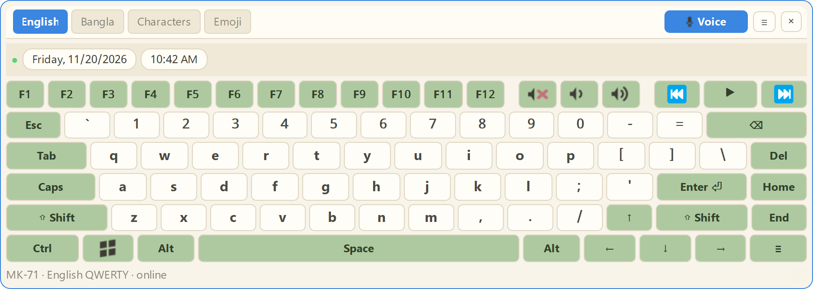
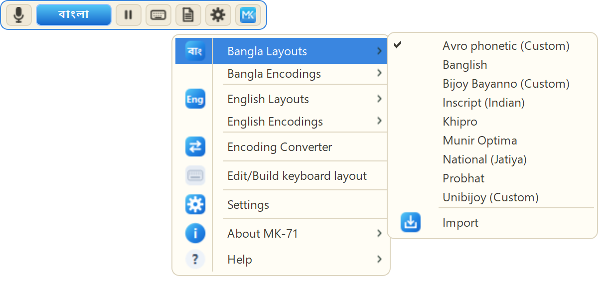

# MK-71 Keyboard

**বাংলা + English অন-স্ক্রিন কিবোর্ড, ডিক্টেশন আর AI প্রুফরিডিং — Windows ৭ থেকে ১১ পর্যন্ত।**
An all-in-one Bangla and English keyboard for Windows: phonetic typing, an on-screen
keypad, voice dictation and optional AI proofreading, in one small app.


**বাংলা কিবোর্ড** — Avro phonetic লেআউট, নিচে সংখ্যা ও যুক্তাক্ষর


**English keyboard** — পূর্ণ QWERTY, ফাংশন কী ও নেভিগেশন


## Why MK-71

- **দুটো ভাষা, এক অ্যাপ** — Avro/ফোনেটিক বা ফিক্সড বাংলা লেআউট, আর সাধারণ ইংরেজি কিবোর্ড।
- **অন্য অ্যাপেও বাংলা** — Ctrl+Alt+K দিয়ে Chrome, Word, Notepad — যেকোনো জায়গায় বাংলা টাইপ।
- **অন-স্ক্রিন কিবোর্ড** — মাউস/টাচ দিয়ে বাংলা, ইংরেজি, চিহ্ন ও ইমোজি।
- **ভয়েস টাইপিং** — মাইকে বলুন, লেখা বসে যাবে। Google Cloud, Groq Whisper, Deepgram, Sarvam AI বা ফ্রি Google Web Speech।
- **এনকোডিং কনভার্টার** — ANSI / Bijoy / Probhat ↔ Unicode।
- **সাজেশন ও অটো-কারেকশন** — পরের শব্দ, তারিখ, সময়, সংখ্যা, ইমোজি, ক্যালকুলেটর।
- **AI প্রুফরিডিং (ঐচ্ছিক)** — নিজের endpoint/key দিলে বানান-যতিচিহ্ন ঠিক, সমার্থক শব্দ, অনুবাদ।
- **অফলাইনে কাজ করে** — ইন্টারনেট ছাড়া টাইপিং, কনভার্টার, লোকাল প্রুফরিড সব চলে; কিছুই ট্র্যাক করে না।

### বিজয় ৫২, অভ্র ও কণ্ঠ — সব ফিচার এক অ্যাপে

বাংলা লেখার জন্য যে সফটওয়্যারগুলো আলাদা করে ইনস্টল করতে হতো, তার কাজগুলো এখন
MK-71-এ এক জায়গাতেই আছে — **বিজয় ৫২, অভ্র আর কণ্ঠ-এর ফিচারগুলো সবই আমাদের
অ্যাপ্লিকেশনের ভেতরে**, আলাদা কিছু ইনস্টল বা সেটআপ ছাড়াই।

| সফটওয়্যার | তার মূল কাজ | MK-71-এ কোথায় |
|---|---|---|
| **অভ্র (Avro)** | ফোনেটিক টাইপিং, যুক্তাক্ষর, অন্য অ্যাপে বাংলা লেখা | বাংলা Layouts → **Avro phonetic (Custom)** ও **Banglish**; Ctrl+Alt+K দিয়ে যেকোনো অ্যাপে |
| **বিজয় ৫২** | বিজয় বায়ান্নো লেআউট, ANSI/বিজয় এনকোডিং, পুরোনো লেখা | **Bijoy Bayanno (Custom)**; **Bangla Encodings** আর **Encoding Converter** (ANSI / Bijoy / Probhat ↔ Unicode) |
| **কণ্ঠ** | ইউনিকোড বাংলা লেখা, একাধিক ফিক্সড লেআউট, লেআউট বদল ও নিজের লেআউট বানানো | **Unibijoy (Custom)**, Inscript, Khipro, Munir Optima, National (Jatiya), Probhat; **Edit/Build keyboard layout** ও **Import** |
| **সবার সাধারণ কাজ** | সাজেশন, অটো-কারেকশন, বানান পরীক্ষা, সংখ্যা/তারিখ, ইমোজি, ইংরেজি কিবোর্ড | সবই আছে — General সেটিংস থেকে আলাদা আলাদা চালু/বন্ধ করা যায় |

এর সাথে যা ওদের কোনোটিতে নেই: **ভয়েস টাইপিং**, ঐচ্ছিক **AI প্রুফরিডিং**, টপ বার ও
সাজেশন বার, আর ২০ পৃষ্ঠার বাংলা ইউজার গাইড — সব একই অ্যাপে।

**টপ বার ও অ্যাপ মেনু** — বাংলা Layouts-এ Avro, Banglish, Bijoy Bayanno, Inscript, Khipro,
Munir Optima, National, Probhat, Unibijoy আর নিজের লেআউট Import


## ১.০.৫-এ নতুন

- **ডিফল্ট থিম এখন White** — নতুন ইনস্টল বা পোর্টেবল কপি প্রথমবার খুললে হালকা থিমেই
  খুলবে; Dark চাইলে Appearance → Colour theme থেকে বদলে নিন।
- আগের (১.০.৪) পরিবর্তনগুলোও আছে — নিচে দেখুন।

## ১.০.৪-এ নতুন

- **Appearance এখন পরিষ্কার** — শুধু **Colour theme** আর **Window opacity**; Font, Font size,
  Key height ও নিচের ব্যাখ্যা বক্স সরানো হয়েছে। ফন্ট ও কী-সাইজ অ্যাপ নিজেই ঠিক রাখে।
- **AI tools এখন Settings → AI-এর ভেতরে** — endpoint/key যেখানে দেওয়া হয়, সেখান থেকেই
  **Open AI tools…** বাটনে প্রুফরিড, সমার্থক শব্দ ও অনুবাদ।
- **Colour theme** — Appearance-এ **Dark / White** ড্রপডাউন।
- টপ বার ডিফল্ট ৬১% ট্রান্সপারেন্সি; দুই থিমে গ্লাস কিবোর্ড, সলিড কী-ক্যাপ।
- **“How to set API key”** গাইড ও ২০ পৃষ্ঠার বাংলা ইউজার গাইড PDF।
- সব ফিক্সের তালিকা → [CHANGELOG.md](CHANGELOG.md)

## ডাউনলোড / Download

Latest build → **[Releases](../../releases/latest)**

| ফাইল | কাদের জন্য |
|---|---|
| `Windows_x64_Portable.zip` | ৬৪-বিট উইন্ডোজ (সবচেয়ে সাধারণ) — আনজিপ করে চালান, ইনস্টল লাগে না |
| `Windows_x32_Portable.zip` | পুরোনো ৩২-বিট উইন্ডোজ ৭/৮.১ |
| `Windows_x64_Installer.zip` / `Windows_x32_Installer.zip` | সেটআপ উইজার্ডসহ |

> SmartScreen বা antivirus সতর্কতা দেখালে **More info → Run anyway** — unsigned free
> build বলে উইন্ডোজ চিনতে চায়; কোডটা এখানেই আছে, নিজে বিল্ড করেও নিতে পারেন।

## দ্রুত শুরু

1. জিপ আনজিপ করুন → `MK-71 Keyboard.exe` চালান।
2. টপ বার উপরে দেখা যাবে: 🎙 মাইক, **বাংলা/English** বাটন, আর বাকি আইকন।
3. টাইপ করতে **⚙ → On-screen keyboard** (Ctrl+Alt+O), অথবা অন্য অ্যাপে বাংলা লিখতে Ctrl+Alt+K।
4. ভয়েস টাইপিং: 🎙 চাপুন (বা Ctrl+Alt+V), বলুন, থামলে লেখা বসে যাবে।

## শর্টকাট

| শর্টকাট | কাজ |
|---|---|
| `Ctrl + Alt + V` | ভয়েস টাইপিং চালু/বন্ধ |
| `Ctrl + Alt + K` / `Ctrl + Shift + L` | বাংলা ↔ English |
| `Ctrl + Alt + X` | বাংলা টাইপিং সাথে সাথে বন্ধ |
| `Ctrl + Alt + O` | অন-স্ক্রিন কিবোর্ড দেখানো/লুকানো |
| `Ctrl + Shift + E` | এনকোডিং কনভার্টার |
| `Ctrl + Alt + A` | AI tools (প্রুফরিড, সমার্থক, অনুবাদ) |

সব শর্টকাট Settings → **Shortcuts** ট্যাব থেকে বদলানো যায়।

## ভয়েস টাইপিং: কোন সার্ভিসে কী লাগে

| সার্ভিস | কী লাগবে | ফ্রি |
|---|---|---|
| Google Web Speech | কিছুই না (ডিফল্ট) | হ্যাঁ, unofficial |
| Google Cloud Speech-to-Text | API key + billing চালু | মাসে ৬০ মিনিট |
| Whisper / OpenAI-compatible (Groq) | endpoint + key | দৈনিক ফ্রি কোটা |
| Deepgram (nova-3) | API key | এককালীন $২০০ ক্রেডিট |
| Sarvam AI | API key | এককালীন ₹১০০ ক্রেডিট |

কোটা শেষ হলে অ্যাপ নিজেই ফ্রি সার্ভিসে নেমে যায়, আর কোটা ফিরলে (Cloud: মাসের ১ তারিখ,
Groq: পরদিন ০০:০১) নিজে থেকেই আবার উন্নত সার্ভিসে ফিরে আসে। key কেবল আপনার
`data/mk71.db`-তে এনক্রিপ্ট হয়ে থাকে — রেপোতে কোনো key নেই।

## সিস্টেম চাহিদা

- Windows 7 SP1 / 8.1 / 10 / 11 (৩২ বা ৬৪-বিট)
- Windows 7/8.1-এ Visual C++ 2015–2019 runtime + KB2999226
- ~২৫০ MB ডিস্ক, ইন্টারনেট শুধু ভয়েস/AI-এর জন্য

## সোর্স থেকে বিল্ড

```powershell
py -3.8 -m pip install PyQt5 pyinstaller
py -3.8 -m PyInstaller --noconfirm --clean "MK-71 Keyboard.spec"
# ফলাফল: dist\MK-71 Keyboard\
```

## প্রাইভেসি

- কোনো টেলিমেট্রি, অ্যাকাউন্ট বা ক্লাউড সিঙ্ক নেই।
- টাইপ করা অক্ষর শুধু আপনার কম্পিউটারে বাংলায় রূপান্তরিত হয়; কোথাও লগ হয় না।
- অডিও কেবল আপনি যে সার্ভিস বেছেছেন সেখানেই যায় — অন্য কোথাও নয়।
- সব সেটিংস আর key থাকে `data/` ফোল্ডারে, আপনার মেশিনে।

## লাইসেন্স ও কৃতজ্ঞতা

- **License: GNU GPL v3.0** — PyQt5 (GPLv3) দিয়ে তৈরি, তাই সোর্সও একই লাইসেন্সে।
  GitHub-এ রেপো বানানোর সময় **Add file → Create new file → `LICENSE` → Choose a
  license template → GNU General Public License v3.0** বেছে নিন, নিখুঁত টেক্সট বসে যাবে।
- ফন্ট: **Noto Sans Bengali** (SIL Open Font License 1.1 — `mk71/assets/fonts/OFL.txt`)
- প্যাকেজিং: PyInstaller · টুলকিট: Qt 5 / PyQt5
- ধন্যবাদ: Avro ও Bijoy লেআউটের ধারণা, এবং যাঁরা বাগ রিপোর্ট করেছেন।

## যোগাযোগ

- Telegram: https://t.me/mk4u71
- GitHub: https://github.com/Mk4u-Me
- Email: Mk4ume@proton.me
